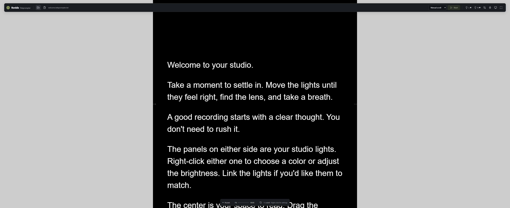

# Rovidx Teleprompter

Turn your ultrawide monitor into a reading studio: a teleprompter in the center, adjustable studio lights on either side, and offline voice following that moves with your words.

Built by **[Rovidx](https://rovidx.com)** · [Report a bug](https://github.com/rovidxmedia/rovidx-teleprompter/issues/new/choose) · [Release notes](https://github.com/rovidxmedia/rovidx-teleprompter/releases)

## Download

**No Node.js or developer tools required.** Choose your operating system and processor. Downloads below always point to the latest complete release.

| Platform                  | Download                                                                                                                                                                                                                                                                       |
| ------------------------- | ------------------------------------------------------------------------------------------------------------------------------------------------------------------------------------------------------------------------------------------------------------------------------ |
| **Windows · x64**         | [Installer](https://github.com/rovidxmedia/rovidx-teleprompter/releases/latest/download/Rovidx-Teleprompter-Windows-x64-Setup.exe) · [Portable app](https://github.com/rovidxmedia/rovidx-teleprompter/releases/latest/download/Rovidx-Teleprompter-Windows-x64-Portable.exe)  |
| **macOS · Apple Silicon** | [Disk image](https://github.com/rovidxmedia/rovidx-teleprompter/releases/latest/download/Rovidx-Teleprompter-macOS-arm64.dmg) · [ZIP](https://github.com/rovidxmedia/rovidx-teleprompter/releases/latest/download/Rovidx-Teleprompter-macOS-arm64.zip)                         |
| **macOS · Intel**         | [Disk image](https://github.com/rovidxmedia/rovidx-teleprompter/releases/latest/download/Rovidx-Teleprompter-macOS-x64.dmg) · [ZIP](https://github.com/rovidxmedia/rovidx-teleprompter/releases/latest/download/Rovidx-Teleprompter-macOS-x64.zip)                             |
| **Linux · x64**           | [AppImage](https://github.com/rovidxmedia/rovidx-teleprompter/releases/latest/download/Rovidx-Teleprompter-Linux-x86_64.AppImage) · [Debian / Ubuntu package](https://github.com/rovidxmedia/rovidx-teleprompter/releases/latest/download/Rovidx-Teleprompter-Linux-amd64.deb) |
| **Linux · ARM64**         | [AppImage](https://github.com/rovidxmedia/rovidx-teleprompter/releases/latest/download/Rovidx-Teleprompter-Linux-arm64.AppImage) · [Debian / Ubuntu package](https://github.com/rovidxmedia/rovidx-teleprompter/releases/latest/download/Rovidx-Teleprompter-Linux-arm64.deb)  |

[All releases](https://github.com/rovidxmedia/rovidx-teleprompter/releases) · [SHA-256 checksums](https://github.com/rovidxmedia/rovidx-teleprompter/releases/latest/download/SHA256SUMS.txt)

Windows and Linux builds are unsigned. macOS builds are ad-hoc signed and are not notarized; your operating system may ask you to approve the app. Voice following needs a one-time English model download of about 70 MB, then works offline.



## Why use it?

- **Light and read from one monitor.** Adjust each side's color, brightness, white preset, and on/off state. Link the lights when you want them to match.
- **Read at your pace.** Choose manual scrolling, steady auto-scroll, or offline English voice following.
- **Keep the camera in view.** Put the reading line in the center, near the top, or at a custom position.
- **Set up your own studio.** Resize all three panels and adjust fonts, spacing, text width, colors, and the reading guide. Preferences are remembered.
- **Stay focused.** Fullscreen mode and controls that hide while you read keep the screen clear.

## Get started

1. Install or open the download for your platform. On macOS, move the app into Applications. On Linux, make the AppImage executable before opening it, or install the `.deb` package.
2. Choose **Open text file** or **Paste text**. Scripts always load paused. Try the included [sample script](examples/welcome.teleprompter.txt).
3. Right-click either light or the center panel to adjust it. The toolbar offers the same settings. Drag a divider to change panel widths.
4. Select **Manual scroll**, **Auto-scroll**, or **Voice following**. For automatic modes, press **Start** or **Space**.

For voice following, open **Voice settings**, download the model, choose your microphone, and allow microphone access when prompted. Pausing stops the microphone. Your place holds during silence or unrecognized speech. If recognition loses your place, scroll to the right passage and restart.

An ultrawide monitor is recommended, but a standard desktop display works too. Use **Choose monitor** in the toolbar to move the app between displays.

## Controls

| Control             | Action                                        |
| ------------------- | --------------------------------------------- |
| Ctrl+O / ⌘O         | Open a text file                              |
| Space               | Start or pause auto-scroll or voice following |
| Up / Down           | Pause and scroll one line                     |
| Left / Right        | Decrease or increase auto-scroll speed        |
| Home / End          | Pause and move to the beginning or end        |
| Mouse wheel         | Pause and scroll manually                     |
| F11 / Escape        | Toggle / leave fullscreen                     |
| Right-click a panel | Open that panel's settings                    |

Shortcuts stay inactive while you type in fields. The toolbar reappears when you move the mouse or focus its controls with the keyboard. Focus a divider and use Left / Right to resize it without a mouse.

## Scripts and formatting skill

The app reads ordinary **UTF-8 `.txt` files** or pasted text. Use blank lines between paragraphs; the app wraps text to your reading column. Supplied cues such as `[PAUSE]` appear as literal text and do not trigger commands. Files can be up to 5 MB; pasted text can be up to 500,000 characters.

The included **[rovidx-teleprompter-script](skills/rovidx-teleprompter-script/SKILL.md)** Codex skill prepares a separate `.teleprompter.txt` copy without changing your wording. It removes document presentation, rejoins hard-wrapped lines, and groups prose into readable paragraphs.

To install the skill, copy [`skills/rovidx-teleprompter-script`](skills/rovidx-teleprompter-script) into your Codex skills directory, usually `~/.codex/skills/`. Invoke `$rovidx-teleprompter-script` with your script. Restart Codex if the skill is not listed.

## Privacy and offline use

Scripts and microphone audio stay on your computer. Audio is processed locally, is never recorded, and is never uploaded. There is no account, cloud speech service, telemetry, or automatic updater.

The initial model download comes from the [pinned sherpa-onnx model repository](https://huggingface.co/csukuangfj/sherpa-onnx-streaming-zipformer-en-2023-06-26). Each file is verified against its SHA-256 hash before use. The app can run offline after this download; manual and steady scrolling work without the model.

Preferences, recent file paths, and model files live in your operating system's per-user application-data directory. Script files remain where you saved them. Pasted text lasts for the current session only.

## Troubleshooting

- **Microphone unavailable:** allow desktop-app microphone access in your operating system's privacy settings, then refresh the microphone list in Voice settings.
- **Voice following holds or loses your place:** reduce background noise, check the chosen microphone, scroll to the right passage, and restart. Repeated phrases, unusual names, and large departures from the script can reduce accuracy.
- **Model download fails:** check your connection and retry in Voice settings. Already verified files are reused; cancelled partial downloads are removed.
- **Linux AppImage does not open:** your distribution may need FUSE support. You can use the `.deb` package on Debian or Ubuntu instead.
- **Something else is wrong:** [open an issue](https://github.com/rovidxmedia/rovidx-teleprompter/issues/new/choose) with your app version, operating system, processor, and steps to reproduce. Please remove private scripts and personal information first.

## Build from source

Requires **Node.js 22.12 or newer**, npm, and a supported desktop operating system. Native speech libraries are architecture-specific; build on the target platform.

```sh
git clone https://github.com/rovidxmedia/rovidx-teleprompter.git
cd rovidx-teleprompter
npm ci
npm run dev
```

```sh
npm test                 # Unit tests
npm run build            # Production app
npm start                # Run the production app
npm run test:speech      # Download public test data and verify native recognition
npm run test:e2e         # Electron desktop tests
npm run package          # Windows installer and portable app
npm run package:mac      # macOS disk image and ZIP
npm run package:linux    # Linux AppImage and Debian package
npm run test:packaged    # Verify voice following in the packaged app
```

On Windows PowerShell, use `npm.cmd` if local execution policy blocks `npm`. Build outputs go to `release/`; test speech models and recordings stay in the ignored `.runtime/` directory. Linux desktop tests need a display; CI uses Xvfb.

GitHub Actions builds Windows x64, macOS Apple Silicon and Intel, and Linux x64 and ARM64 on native runners. A matching version tag publishes the release only after every platform's build and packaged voice test passes. See [contribution guidance](CONTRIBUTING.md) and [validation notes](VALIDATION.md).

## Contributing and support

Bug reports, focused fixes, and suggestions are welcome. Read [CONTRIBUTING.md](CONTRIBUTING.md) before opening a pull request. GitHub issues are the place for app bugs; visit **[Rovidx.com](https://rovidx.com)** to learn more about Rovidx.

## License and credits

Copyright © 2026 [Rovidx](https://rovidx.com). Released under the **[MIT license](LICENSE)**.

Built with [Electron](https://www.electronjs.org), [React](https://react.dev), [Vite](https://vite.dev), [Lucide](https://lucide.dev), and [sherpa-onnx](https://github.com/k2-fsa/sherpa-onnx). The English model is converted from the icefall LibriSpeech streaming Zipformer model. Dependencies and model files retain their own licenses; see their source repositories and [the pinned model manifest](electron/model-manifest.json).
